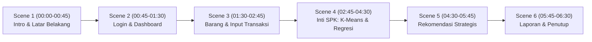

# PANDUAN LENGKAP & ALUR VIDEO DEMO SISTEM PENDUKUNG KEPUTUSAN (SPK)
## "Sistem Pendukung Keputusan Strategis Stok & Analisis Penjualan UMKM Menggunakan K-Means Clustering & Linear Regression"

---

## 1. Parameter & Standar Video Rekomendasi
- **Durasi Ideal**: 5 – 7 Menit (durasi optimal untuk sidang skripsi, presentasi penguji, atau portofolio klien).
- **Resolusi**: Minimal 1080p (Full HD 1920x1080) pada 60 fps atau 30 fps.
- **Rasio Layar**: 16:9 Widescreen.
- **Software Rekaman**: OBS Studio (disarankan) atau Camtasia / Bandicam.
- **Audio / Mic**: Suara narator jelas, tanpa noise bising latar, intonasi tenang, percaya diri, dan profesional.

---

## 2. Checklist Persiapan Sebelum Merekam (Pre-recording)
Sebelum menekan tombol *Record*, pastikan hal-hal berikut telah siap:

1. [ ] **Data Terisi Bersih**:
   - Pastikan database memiliki data transaksi historis minimal 3–12 bulan (misal rentang tahun 2024) agar model regresi dan klaster menghasilkan visual grafik yang kaya.
   - *Tips*: Jika butuh reset data uji siap pakai, jalankan `php artisan migrate:fresh --seed`.
2. [ ] **Tampilan Layar Bersih**:
   - Browser zoom standar 100% atau 110% (agar teks terbaca jelas di layar kecil).
   - Sembunyikan *Bookmarks Bar* (tekan `Ctrl + Shift + B` di Chrome/Edge).
   - Masuk mode fullscreen jika diperlukan (`F11`), atau rekam area jendela kerja aplikasi saja.
   - Matikan notifikasi Windows (*Focus Assist / Do Not Disturb* aktif).
3. [ ] **Cursor Mouse Jelas**:
   - Aktifkan efek highlight mouse kuning (misal pakai bawaan OBS/Camtasia atau software *Cursor Highlight*) agar penonton mudah mengikuti tombol mana yang Anda klik.

---

## 3. Storyboard & Alur Waktu Video (Scene by Scene)

---

### SCENE 1: Pembukaan & Latar Belakang Masalah (00:00 – 00:45)
- **Tampilan Visual**: Halaman Landing Page / Login awal aplikasi, atau slide judul bersih (3 detik pertama) lalu transisi ke layar login.
- **Aksi Kursor**: Kursor berada di tengah layar, belum mengetik.
- **Panduan Narasi Suara (Voiceover)**:
  > *"Halo semuanya, perkenalkan saya [Nama Anda]. Pada video kali ini saya akan mendemonstrasikan Sistem Pendukung Keputusan Strategis Stok dan Analisis Penjualan UMKM.*  
  > *Masalah klasik yang sering dihadapi pelaku usaha adalah overstock pada barang yang sepi peminat dan sebaliknya kehabisan stok pada produk yang sedang laris karena pencatatan manual tanpa prediksi deret waktu.*  
  > *Sistem ini hadir untuk mengintegrasikan algoritma K-Means Clustering untuk segmentasi produk dan Linear Regression untuk peramalan kebutuhan stok di masa depan secara otomatis dan akurat."*

---

### SCENE 2: Autentikasi & Dashboard Ringkasan (00:45 – 01:30)
- **Tampilan Visual**: Form Login $\rightarrow$ Dashboard Utama.
- **Aksi Kursor**:
  1. Masukkan akun pemilik UMKM, klik **Masuk**.
  2. Sorot kartu metrik utama di dashboard (Total Penjualan Bulan Ini, Jumlah Produk Aktif, Indikator Stok Kritis).
  3. Gulir ke grafik tren penjualan bulanan.
- **Panduan Narasi Suara (Voiceover)**:
  > *"Kita mulai dengan masuk ke akun pemilik UMKM. Sistem ini menerapkan Owner-Isolation yang ketat, sehingga seluruh data katalog, stok, dan transaksi terisolasi secara aman.*  
  > *Di halaman Dashboard, pemilik usaha dapat langsung melihat ringkasan kondisi bisnis secara real-time: performa pendapatan bulanan, produk yang membutuhkan perhatian stok, serta tren penjualan terkini yang bersih dan mudah dibaca."*

---

### SCENE 3: Katalog Barang & Pengelolaan Transaksi (01:30 – 02:45)
- **Tampilan Visual**: Menu **Data Barang** $\rightarrow$ Menu **Transaksi Penjualan**.
- **Aksi Kursor**:
  1. Buka menu Data Barang, perlihatkan tabel produk, stok fisik saat ini, dan harga jual/modal.
  2. Masuk ke menu Transaksi: tunjukkan cara input transaksi cepat atau sorot fitur **Import Transaksi (Excel/CSV)**.
  3. Tunjukkan bahwa sistem memvalidasi kelengkapan tanggal, mencegah duplikasi baris data, dan stok terpotong secara otomatis secara atomik.
- **Panduan Narasi Suara (Voiceover)**:
  > *"Selanjutnya pada menu Data Barang, kita dapat mengelola komoditas dan memantau stok fisik secara langsung.*  
  > *Untuk transaksi penjualan, sistem menyediakan dua metode: pencatatan transaksi langsung dan fitur Import file Excel/CSV riwayat transaksi. Sistem dilengkapi proteksi validasi otomatis yang menolak anomali data, memastikan data deret waktu yang masuk ke algoritma benar-benar valid dan bebas error."*

---

### SCENE 4: Inti Sistem — Proses Analisis K-Means & Linear Regression (02:45 – 04:30)
*(Ini adalah babak paling krusial untuk penguji/dosen)*
- **Tampilan Visual**: Menu **Analisis SPK**.
- **Aksi Kursor**:
  1. Tunjukkan panel filter: pilih periode data transaksi historis (contoh: Januari 2024 s/d Desember 2024).
  2. Klik tombol **Jalankan Analisis SPK** (tunggu proses hitung sejenak).
  3. Sorot hasil **K-Means Clustering**:
     - Tunjukkan tabel 3 kelompok: *Sangat Laris (C1)*, *Cukup Laris (C2)*, dan *Kurang Laris (C3)*.
     - Sorot kartu evaluasi *Skor Silhouette Coefficient* (misal: struktur klaster kuat dan teruji konvergen).
  4. Sorot hasil **Linear Regression**:
     - Pilih salah satu produk unggulan, perlihatkan grafik garis tren penjualan historis dan titik proyeksi bulan berikutnya.
     - Tunjukkan kotak evaluasi akurasi peramalan: nilai **MAE** (rata-rata simpangan unit) dan **RMSE**.
     - Buka sekilas accordion dropdown **Metadata Teknis (JSON)** untuk membuktikan transparansi bobot algoritma.
- **Panduan Narasi Suara (Voiceover)**:
  > *"Sekarang kita masuk ke fitur utama: Analisis SPK.*  
  > *Kita memilih periode analisis data historis selama 1 tahun, lalu mengeksekusi proses analisis.*  
  > *Di tahap pertama, algoritma K-Means secara otomatis menstandarisasi volume dan frekuensi transaksi menggunakan Z-Score, lalu mengelompokkan barang ke dalam tiga klaster: Sangat Laris, Cukup Laris, dan Kurang Laris. Kualitas segmentasi divalidasi dengan Silhouette Coefficient untuk memastikan pemisahan klaster objektif.*  
  > *Di tahap kedua, algoritma Linear Regression memproyeksikan estimasi kebutuhan unit barang pada periode berikutnya berdasarkan tren deret waktu. Model ini divalidasi secara ilmiah menggunakan metode Rolling-Origin Validation, lengkap dengan metrik MAE dan RMSE untuk mengukur tingkat kepresisian prediksi."*

---

### SCENE 5: Rekomendasi Keputusan Stok Strategis (04:30 – 05:45)
- **Tampilan Visual**: Menu **Rekomendasi Stok**.
- **Aksi Kursor**:
  1. Masuk ke halaman Rekomendasi Stok.
  2. Tunjukkan kartu ringkasan keputusan (Jumlah barang yang harus segera ditambah, dipertahankan, atau dikurangi).
  3. Sorot satu contoh baris produk berstatus **"Tambah Stok Segera"** (karena termasuk klaster laris dan stok fisiknya menipis di bawah angka prediksi).
  4. Sorot satu contoh baris produk berstatus **"Kurangi Pengadaan / Diskon"** (karena masuk klaster kurang laris dan stok menumpuk di gudang).
  5. Tunjukkan fitur pencarian dan filter kategori rekomendasi.
- **Panduan Narasi Suara (Voiceover)**:
  > *"Seluruh hasil perhitungan algoritma kemudian diterjemahkan ke dalam halaman Rekomendasi Keputusan Stok.*  
  > *Di sini, sistem memadukan klaster K-Means, proyeksi Linear Regression, serta sisa stok fisik riil di gudang menjadi arahan tindakan bisnis yang konkret.*  
  > *Sebagai contoh, produk beras ini berada di klaster Sangat Laris dengan proyeksi penjualan tinggi sementara sisa stoknya menipis, maka sistem langsung memberi status prioritas: Tambah Stok Segera.*  
  > *Sebaliknya, produk yang berada di klaster Kurang Laris dengan stok gudang berlebih akan disarankan untuk Kurangi Pengadaan atau diberikan program promosi agar perputaran modal tidak macet."*

---

### SCENE 6: Pelaporan (Export PDF & Excel) & Penutup (05:45 – 06:30)
- **Tampilan Visual**: Tombol **Export PDF** / **Export Excel** $\rightarrow$ File PDF terbuka di layar $\rightarrow$ Kembali ke layar profil / dashboard.
- **Aksi Kursor**:
  1. Klik tombol **Cetak Laporan PDF**. Buka file PDF hasil unduhan (tunjukkan format laporan formal yang rapi dengan kop UMKM, tanda tangan pemilik, dan tabel rekomendasi).
  2. Tutup tab PDF, kembali ke aplikasi.
  3. Sampaikan kesimpulan dan salam penutup.
- **Panduan Narasi Suara (Voiceover)**:
  > *"Untuk kebutuhan dokumentasi formal, pengajuan pengadaan, atau arsip audit, hasil rekomendasi dan rekapitulasi stok dapat langsung diunduh dalam format PDF maupun Excel dengan sekali klik.*  
  > *Dengan adanya sistem pendukung keputusan ini, pemilik UMKM dapat mengambil keputusan pengadaan stok secara tepat, meminimalkan risiko modal tertahan, dan memaksimalkan omzet penjualan berdasarkan analisis data yang akurat.*  
  > *Demikian demonstrasi sistem ini. Terima kasih atas perhatiannya, salam hangat dan semoga bermanfaat."*

---

## 4. Tips Mengantisipasi Pertanyaan Penguji / Dosen
Jika video demo ini dinilai dalam sidang skripsi / review tugas akhir, pastikan Anda siap dengan 4 poin ini:
1. **Kenapa K-Means butuh Z-Score?**  
   *Jawaban*: Untuk menyetarakan skala antara volume penjualan (misal ratusan kilogram) dan frekuensi transaksi (misal puluhan kali), sehingga perhitungan jarak Euclidean tidak didominasi oleh salah satu variabel saja.
2. **Kenapa pakai Rolling-Origin Validation pada Regresi Linier?**  
   *Jawaban*: Karena data penjualan adalah deret waktu (*time-series*). Kita tidak boleh mengacak data seperti cross-validation biasa agar masa depan tidak bocor (*data leakage*). Evaluasi dilakukan dengan simulasi maju bertahap.
3. **Apa arti nilai MAE pada aplikasi?**  
   *Jawaban*: MAE (*Mean Absolute Error*) menunjukkan rata-rata selisih antara jumlah unit yang diprediksi sistem dengan data penjualan aktual di lapangan.
4. **Dari mana dasar pengambilan keputusan stoknya?**  
   *Jawaban*: Berdasarkan matriks silang antara Klaster K-Means (Laris/Sedang/Kurang), Angka Ramalan Stok Regresi Linier, dan Saldo Stok Fisik Terkini di toko.
